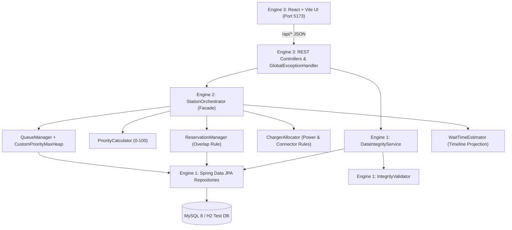

# EVChargeFlow — System Architecture

## High-Level Architecture

EVChargeFlow follows a layered 4-engine modular monolith architecture using React (Vite) on the frontend, Spring Boot 3.3 (Java 17) on the backend, and MySQL 8 for relational persistence.

---

## Core Decision Pipeline (Charging Request Flow)

1. **Input & Integrity Check (Engine 1):** Verify vehicle exists, station exists and is `OPERATIONAL`, battery is `0–100%`, duration is `5–480` minutes, and no duplicate active (`QUEUED`/`ASSIGNED`/`CHARGING`) request exists for the vehicle.
2. **Compatibility Guard (Engine 2):** Ensure at least one `OPERATIONAL` charger at the station supports the requested connector and fits within the station's maximum power capacity. Otherwise return `REJECTED`.
3. **Priority Calculation (Engine 2):**
   - **Battery Urgency (0–50 pts):** `0–10% → 50`, `11–20% → 40`, `21–30% → 30`, `31–40% → 20`, `41–60% → 10`, `>60% → 0`
   - **Departure Urgency (0–30 pts):** `≤30m → 30`, `31–60m → 25`, `61–120m → 15`, `121–240m → 5`, `>240m or null → 0`
   - **Waiting Time (0–20 pts):** `≥60m → 20`, `45–59m → 15`, `30–44m → 10`, `15–29m → 5`, `<15m → 0`
4. **Allocation or Queueing (Engine 2):**
   - Try `ChargerAllocator.findFeasibleCharger()` checking operational status, `AVAILABLE` state, connector match, `currentlyAllocatedPowerKw + charger.powerRatingKw <= station.maxPowerCapacityKw`, and no reservation overlap.
   - If a charger is available → `ASSIGNED` (lock charger, set `request` to `ASSIGNED`).
   - Otherwise → `QUEUED` (`WAITING` result): inserted into `CustomPriorityMaxHeap` (array-backed Max Heap, no `java.util.PriorityQueue`), and `WaitTimeEstimator` computes an explainable non-guaranteed wait projection.
