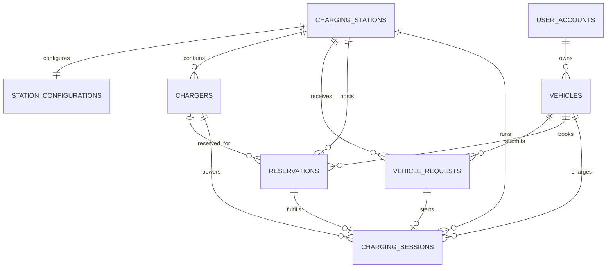

# EVChargeFlow — Relational Database Schema

EVChargeFlow uses a relational database (MySQL 8 in production, H2 in MySQL compatibility mode for automated tests) managed via Spring Data JPA / Hibernate.

## Entity Relationship Diagram

---

## Tables & Key Constraints

| Table | Primary Key | Key Columns & Constraints |
|---|---|---|
| `user_accounts` | `user_id` | `full_name`, `email` (unique), `phone`, `role` (`DRIVER`, `OPERATOR`) |
| `charging_stations` | `station_id` | `name`, `location`, `status` (`OPERATIONAL`, `MAINTENANCE`, `OFFLINE`), `max_power_capacity_kw` (10–5000) |
| `station_configurations` | `station_id` (FK `@MapsId`) | `queue_refresh_interval_sec`, `reservation_grace_period_min`, `charging_efficiency_factor`, `default_charging_duration_min`, `auto_allocation_enabled`, `simulation_speed_multiplier` |
| `chargers` | `charger_id` | `station_id` (FK), `name`, `charger_type`, `power_rating_kw` (3.7–350), `operational_status`, `availability_status`, `current_vehicle_id`, `current_request_id` |
| `charger_connectors` | `(charger_id, connector_type)` | Collection table storing supported `ConnectorType` values (`CCS`, `TYPE2`, `CHADEMO`, `NACS`) |
| `vehicles` | `vehicle_id` | `registration_number` (unique), `owner_id` (FK nullable), `owner_name`, `model`, `connector_type`, `battery_capacity_kwh` (10–250), `current_battery_percent` (0–100) |
| `vehicle_requests` | `request_id` | `vehicle_id` (FK), `station_id` (FK), `current_battery_percent`, `required_connector`, `expected_duration_minutes`, `arrival_time`, `desired_departure_time`, `battery_score`, `departure_score`, `waiting_time_score`, `priority_score`, `status`, `assigned_charger_id`, `estimated_wait_minutes` |
| `reservations` | `reservation_id` | `vehicle_id` (FK), `station_id` (FK), `charger_id` (FK), `start_time`, `end_time`, `status` (`CONFIRMED`, `ACTIVE`, `COMPLETED`, `CANCELLED`, `EXPIRED`) |
| `charging_sessions` | `session_id` | `request_id` (FK nullable), `reservation_id` (FK nullable), `vehicle_id` (FK), `station_id` (FK), `charger_id` (FK), `start_time`, `expected_end_time`, `actual_end_time`, `allocated_power_kw`, `energy_consumed_kwh`, `status` (`ACTIVE`, `COMPLETED`, `STOPPED`), `is_simulated` |
| `audit_logs` | `log_id` | `category`, `action`, `details`, `created_at` |
